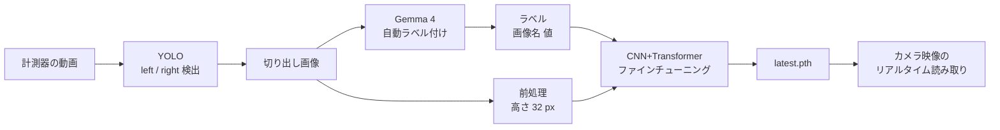

# 計測器デジタル表示の自動読み取り — ファインチューニング

カメラ映像から計測器の 7 セグメント表示を読み取るための研究用コードです。
表示は **仮数部（`left`）** と **指数部（`right`）** に分かれており、読み値は `left × 10^right` として出力します。

- **YOLO** で表示領域（`left` / `right`）を検出
- **CNN + Transformer（CTC）** で切り出した領域の数字列を認識
- 新しい撮影条件に適応させるため、ローカルで動かす **Gemma 4（llama.cpp）** で切り出し画像に自動でラベルを付け、そのラベルで認識モデルをファインチューニング

## 処理の流れ



## 認識モデル（CNN + Transformer）

定義は [cnn_transformer/cnn_transformer.py](cnn_transformer/cnn_transformer.py) にあります（クラス名は `CRNN`）。

| 項目 | 内容 |
| --- | --- |
| 入力 | 高さ 32 px 固定・幅可変。グレースケール版は 1ch、カラー版は 3ch |
| CNN | VGG 風の畳み込み 10 層。高さ方向を 1 まで潰して横方向の特徴列を作る |
| Transformer | 正弦波位置エンコーディング + Encoder 4 層（d_model 512、8 heads、Pre-LN、GELU） |
| 出力 | CTC（blank + `0123456789.-` の 13 クラス）、greedy デコード |
| 学習 | CTCLoss、AdamW、CosineAnnealingLR、勾配クリップ 5.0、検証 10%。検証の完全一致率が最も高いエポックを保存 |

前処理はモデルによって異なります。

- **グレースケール版**（`cnn_transformer/`）: G チャンネル → CLAHE → 二値化（しきい値 95）→ 小さな白ノイズ除去 → 高さ 32 にリサイズ
- **カラー版**（`cnn_transformer_color/`）: 切り出し画像をそのまま高さ 32 にリサイズし、BGR → RGB に変換

## ディレクトリ構成

```
finetune/
├── main.py                 # 一括実行（カラー版）：自動ラベル付け → ファインチューニング → リアルタイム読み取り
├── frame.py                # 動画からフレームを抽出（YOLO アノテーション用）
├── yolo_video.py           # YOLO で検出した表示領域を動画から切り出す
├── generate_labels.py      # カラー版モデルで動画を読み取り、切り出し画像とラベルを出力
├── class.py                # 切り出し画像をファイル名の末尾（_left / _right）で振り分け
├── multi.yaml              # YOLO データセット設定（classes: left, right）
├── cnn_transformer/        # グレースケール版：モデル定義・Dataset・学習
├── cnn_transformer_color/  # カラー版（入力 3ch）
├── gemma4/                 # Gemma 4 による自動ラベル付けとラベルの評価
├── image_processing/       # 二値化などの前処理
├── finetuning/             # ファインチューニングと動画での読み取り評価
├── models/                 # 学習済みモデル
├── datasets2_yolo/         # YOLO 学習用ラベル（画像は未同梱）
├── datasets3_yolo/         # 同上
└── runs/                   # Ultralytics の学習ログ
```

## 環境

開発時の環境は次のとおりです。

- Python 3.14
- PyTorch 2.11（CUDA 12.6）
- Ultralytics 8.4
- OpenCV 4.13 / NumPy 2.4 / requests

```bash
pip install torch ultralytics opencv-python numpy requests
```

GPU があれば自動で使用します（`cuda` が使えない場合は CPU）。

### Gemma 4（自動ラベル付けを使う場合のみ）

[llama.cpp](https://github.com/ggml-org/llama.cpp) の `llama-server` で、画像入力に対応した Gemma 4 を OpenAI 互換 API として起動しておきます。
スクリプトは `http://127.0.0.1:8080/v1/chat/completions` にモデル名 `gemma4` でリクエストします。

```bash
llama-server -m <Gemma 4 の GGUF> --mmproj <対応する mmproj の GGUF> --port 8080
```

## 使い方

各スクリプトはコマンドライン引数を取らず、**ファイル先頭の定数**（`VIDEO_PATH`、`IMG_DIR`、`LABELS_TXT`、`BASE_MODEL_PATH` など）で入出力を指定します。
パスは `finetune/` からの相対パスなので、`finetune/` をカレントディレクトリにして実行してください。
`VIDEO_PATH` は開発者の環境を指しているため、手元の動画のパスに書き換えてください。

### 1. YOLO（表示領域の検出）

1. [frame.py](frame.py) で動画からフレームを抽出し、`left` / `right` の 2 クラスで YOLO 形式のアノテーションを付けます。
2. [multi.yaml](multi.yaml) にデータセットのパスを書き、Ultralytics で追加学習します。

```bash
yolo detect train model=models/yolo_machine2/text-best.pt data=multi.yaml \
    epochs=50 imgsz=640 batch=8 project=models/yolo_machine2 name=slip_finetune
```

### 2. Gemma 4 による自動ラベル付け

[gemma4/gemma4_labels.py](gemma4/gemma4_labels.py) が次の処理を行います。

1. 動画から `TARGET_FPS` ごとにフレームを取り出し、YOLO でクラスごとに信頼度が最も高い領域を切り出す
2. 切り出し画像を Gemma 4 に渡し、`{"value": ..., "confidence": ...}` の JSON で読み値を返させる
3. 次の条件を満たしたものだけをラベルファイルに追記する
   - 値がクラスごとの範囲内（`left`: 1.0〜9.9、`right`: −5〜5）
   - 信頼度が `GEMMA_CONF_THRES` 以上
   - 同じ値のラベル数が上限（`LABEL_MAX_COUNT`）未満
4. すべての値が上限枚数に達したら停止する

補助スクリプト:

| スクリプト | 内容 |
| --- | --- |
| [gemma4/label.py](gemma4/label.py) | ラベルファイルを `left` / `right` に分割 |
| [finetuning/data_count.py](finetuning/data_count.py) | 値ごとのラベル数を集計 |
| [gemma4/diff_labels.py](gemma4/diff_labels.py) | 正解ラベルと比較して正答率と誤りを表示 |
| [gemma4/gemma4_test.py](gemma4/gemma4_test.py) | 自動ラベル付けの初期版（切り出しをまとめて行ってから評価） |

### 3. 前処理（グレースケール版のみ）

[image_processing/ip_machine2.py](image_processing/ip_machine2.py) で、ラベルファイルに載っている画像を二値化し、高さ 32 px にそろえます。
カラー版はこの処理を使いません。

### 4. ファインチューニング

| スクリプト | 対象 |
| --- | --- |
| [finetuning/finetune.py](finetuning/finetune.py) | グレースケール版 |
| [finetuning/finetune_color.py](finetuning/finetune_color.py) | カラー版 |

`BASE_MODEL_PATH` の重みから学習を始め、`FINETUNED_SAVE_DIR` に `finetuned_YYYYMMDD_HHMMSS.pth` を保存し、同じ内容を `latest.pth` にコピーします。
`USE_LATEST_IF_EXISTS = True` にすると、前回の `latest.pth` から続けて学習します。

ゼロから学習する場合は [cnn_transformer/training.py](cnn_transformer/training.py)（グレースケール）、[cnn_transformer_color/training.py](cnn_transformer_color/training.py)（カラー）を使います。

### 5. 動画での評価

| スクリプト | 内容 |
| --- | --- |
| [finetuning/check_model.py](finetuning/check_model.py) | グレースケール版で動画を読み取り、結果をラベル形式で出力 |
| [finetuning/check_model_color.py](finetuning/check_model_color.py) | カラー版。読めなかった領域は `__UNREADABLE__` と記録 |

出力したファイルを [gemma4/diff_labels.py](gemma4/diff_labels.py) で正解ラベルと比較します。

### 6. 一括実行とリアルタイム読み取り（カラー版）

[main.py](main.py) は、次の工程を順に実行します。

1. Gemma 4 による自動ラベル付け（[gemma4/gemma4_labels.py](gemma4/gemma4_labels.py)）
2. ラベル数の確認
3. カラー版のファインチューニング（[finetuning/finetune_color.py](finetuning/finetune_color.py)）
4. ファインチューニングしたモデル（`latest.pth`）による、カメラ映像のリアルタイム読み取り

```bash
cd finetune
python main.py
```

`main.py` は各スクリプトを import して実行します。
工程間でそろえる必要がある設定（動画、YOLO モデル、画像フォルダ、ラベルファイル、開始モデル、保存先、値の範囲、ラベル枚数）は、`main.py` 先頭の値で各スクリプトの設定を上書きします。
抽出 FPS や学習率などの細かい設定は、それぞれのスクリプトの値が使われます。

- 先に llama-server を起動しておいてください。接続できない場合は、ラベル付けを始める前にエラーで止まります。
- ラベルは追記で集めます。既存の画像とラベルは消しません。`VIDEO_PATH` を変えて再実行すれば、別の動画からラベルを追加できます。
- すべての値のラベル数が `LABEL_MIN_COUNT` に届いていない場合は、ファインチューニング以降を実行せずに終了します。`REQUIRE_ALL_LABELS_MIN_COUNT = False` にすると、今あるラベルで学習に進みます。
- 各工程は `RUN_GEMMA_LABELS`、`RUN_FINETUNING`、`RUN_LATEST_MODEL_READING` で個別にオン・オフできます。
- リアルタイム読み取りは `CAMERA_SOURCE`（カメラ番号、または動画ファイルのパス）から映像を読み、`9.4×10^4` のように表示します。`q` キーで終了します。
- 読み値は `realtime_latest_reading_log.txt` にも記録されます。

## ラベルファイルの形式

1 行に 1 画像、画像ファイル名と値を半角スペースで区切ります。

```
machine2_3h_t000.51s_left.jpg 9.4
machine2_3h_t001.02s_right.jpg 4
```

切り出し画像のファイル名は `<動画名>_t<秒>s_<クラス>.jpg` です。

## 学習済みモデル

| パス | 内容 |
| --- | --- |
| `models/yolo_machine2/text-best.pt` | 表示領域（left / right）検出のベース YOLO |
| `models/yolo_machine2/brightness.pt`、`slip.pt` | 撮影条件ごとに追加学習した YOLO |
| `models/yolo_machine2/yolov8n.pt`、`yolo26n.pt` | Ultralytics の事前学習済み重み |
| `models/transformer/hf_base-model.pth` | Hugging Face の公開データセットで学習したベースモデル（グレースケール） |
| `models/transformer/best-model*.pth` | 計測器の画像で学習したグレースケール版 |
| `models/transformer/finetuned-models/` | グレースケール版のファインチューニング結果 |
| `models/transformer_color/` | カラー版 |
| `models/finetuning_dark/`、`models/finetuning_slip/` | 撮影条件ごとのファインチューニング結果（カラー版） |

`.pth` は `state_dict` のみを保存しています。読み込み例:

```python
import torch
from cnn_transformer.cnn_transformer import CRNN
from cnn_transformer.utils import ALPHABET

model = CRNN(nclass=len(ALPHABET) + 1, nc=1)  # カラー版は nc=3
model.load_state_dict(torch.load("models/transformer/hf_base-model.pth", map_location="cpu"))
model.eval()
```

## データについて

画像と動画（`*.png`、`*.jpg`、`*.mp4` など）は `.gitignore` で除外しているため、このリポジトリには含まれていません。
含まれているのは YOLO のアノテーション（`datasets*_yolo/labels/`）とテキストのラベルファイルだけです。
再現する場合は、手元で計測器の動画を用意してください。
